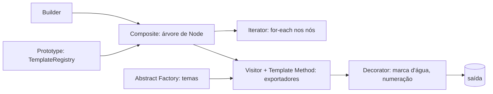

# Projeto Final de Design Patterns — Documentos/Exportação

Biblioteca Java 21 importável para montar documentos (seções, parágrafos, tabelas) e exportá-los
para vários formatos (HTML, Markdown, "PDF" em texto), com temas e efeitos de saída plugáveis.
Este README explica **as decisões** do projeto. A explicação didática de cada pattern e do código
está em [docs/patterns.md](docs/patterns.md).

## Integrantes

| Aluno | Nome completo | Patterns |
| --- | --- | --- |
| Aluno 1 | NOME COMPLETO | Builder + Composite |
| Aluno 2 | NOME COMPLETO | Visitor + Template Method |
| Aluno 3 | NOME COMPLETO | Decorator + Iterator |
| Aluno 4 | NOME COMPLETO | Abstract Factory + Prototype |

**Vídeo:** https://www.youtube.com/watch?v=COLOCAR_LINK_AQUI

## Como rodar e importar

```bash
./gradlew build                    # compila e roda os testes
./gradlew :example:run             # demonstração completa
./gradlew :lib:publishToMavenLocal # publica br.pucpr:docs-patterns:0.1.0
```

Em outro projeto: `repositories { mavenLocal() }` e
`implementation("br.pucpr:docs-patterns:0.1.0")`. O módulo `example/` é exatamente esse cliente
externo.

## Por que o tema Documentos/Exportação

O critério principal do trabalho é uma biblioteca **extensível por quem a usa** (Open/Closed).
Documentos têm, naturalmente, os quatro eixos de variação que um cliente quer estender sem tocar
na lib:

1. **O que** compõe o documento (estrutura em árvore).
2. **Para onde** ele é exportado (formatos).
3. **Com que aparência** (temas).
4. **Com que efeitos extras** na saída (marca d'água, numeração).

Cada pattern foi escolhido para cobrir um desses eixos, ou o jeito de criar e percorrer a árvore.
Assim, nenhum pattern aparece só para "cumprir tabela", e os 8 conversam entre si num fluxo só:
montar → percorrer → exportar → decorar.

## Decisões por pattern

### Estrutura do documento: Composite + Builder (Aluno 1)
- **Composite:** um documento é uma árvore (seção dentro de seção). Tratar seção e parágrafo
  pela mesma interface `Node` deixa o resto da lib ignorar a profundidade. A alternativa, uma lista
  plana com "nível", foi descartada, porque empurra a lógica de hierarquia para cada exportador.
- **Builder:** montar a árvore na mão exige criar e ligar nós e lembrar qual seção está aberta. O
  Builder fluente esconde isso e valida o resultado no `build()`. Construtores com muitos
  parâmetros e setters soltos foram descartados, porque permitem documentos inválidos.

### Exportação: Visitor + Template Method (Aluno 2)
- **Visitor vs Strategy+Registry:** chegamos a considerar uma `ExportStrategy` registrada por
  nome. Ela resolve "trocar o formato", mas cada estratégia acabaria com `instanceof` para saber
  se o nó é seção, parágrafo ou tabela. O Visitor dá o despacho por tipo de nó de graça, e um
  formato novo é só uma classe nova. O `JsonExporter` do `example/` foi escrito **fora da lib**
  para provar isso. O custo conhecido é que um tipo de nó novo obriga a mudar todos os visitantes,
  e aceitamos esse custo porque, no domínio, os tipos de nó mudam bem menos que os formatos.
- **Template Method:** todo formato segue cabeçalho → corpo → rodapé. Deixar o fluxo `final` na
  classe base evita que cada exportador reimplemente (e erre) a ordem, e o rodapé é um hook
  opcional. A alternativa por composição (passar os passos como lambdas) foi descartada por ser
  menos legível para o grupo estudar.
- **Observer (descartado):** pensamos em notificar progresso da exportação, mas não havia um
  problema real do domínio que ele resolvesse, então só adicionaria complexidade.

### Saída e percurso: Decorator + Iterator (Aluno 3)
- **Decorator vs herança:** com herança, marca d'água e numeração em 3 formatos virariam
  `HtmlComMarcaDagua`, `PdfNumerado`, `PdfNumeradoComMarcaDagua`... (explosão de subclasses). O
  Decorator embrulha **qualquer** exportador e pode ser empilhado em tempo de execução.
- **Iterator explícito vs recursão:** a recursão já existe dentro dos exportadores, mas obriga
  cada cliente que só quer "passar por todos os nós" (contar tabelas, buscar texto) a reescrevê-la
  e conhecer `Section`. Com `Document implements Iterable<Node>`, o cliente usa `for-each` sem
  conhecer a estrutura, e outros percursos (em largura, por exemplo) seriam iteradores novos.

### Aparência e reaproveitamento: Abstract Factory + Prototype (Aluno 4)
- **Abstract Factory vs enum de tema:** um `enum Tema { CLASSIC, DARK }` com `switch` nos
  exportadores obrigaria a mexer na lib a cada tema novo e espalharia o `switch` por todo lado. A
  fábrica entrega uma **família coerente** de estilos (título, parágrafo e tabela combinando), e um
  tema novo é só uma fábrica nova.
- **Prototype vs Builder repetido:** para documentos-modelo (ex: "relatório padrão" que todo mês
  muda só o título), repetir o Builder duplica código e cria risco de divergência. Clonar um
  modelo registrado é mais barato e garante cópia profunda, então editar a cópia nunca altera o
  original.

## Como a escolha garante Open/Closed

| Extensão que o cliente quer | Como faz | Mexe na lib? |
| --- | --- | --- |
| Novo formato (JSON, CSV...) | estende `AbstractExporter` | não |
| Novo tema | implementa `ThemeFactory` | não |
| Novo efeito de saída | estende `ExporterDecorator` | não |
| Novo modelo de documento | `TemplateRegistry.register(...)` | não |
| Novo percurso | implementa `Iterator<Node>` | não |
| Novo **tipo de nó** | precisa de um método novo no Visitor | **sim** (trade-off aceito) |



## Divisão por aluno

Os patterns foram agrupados em pares que trabalham juntos, para que cada pessoa explique uma
decisão completa no vídeo:

- **Aluno 1 — Builder + Composite:** como o documento é estruturado e montado.
- **Aluno 2 — Visitor + Template Method:** como a exportação funciona e se estende.
- **Aluno 3 — Decorator + Iterator:** como a saída é enriquecida e a árvore é percorrida.
- **Aluno 4 — Abstract Factory + Prototype:** temas e reaproveitamento de modelos.

## Trade-offs e limitações conhecidas

- Adicionar um tipo de nó exige mudar o `DocumentVisitor` (custo clássico do Visitor).
- O "PDF" é texto simplificado, sem uma biblioteca de PDF de verdade.
- O `PageNumberDecorator` pagina por número de linhas, não por altura real da página. A última
  página nunca fica com uma linha só, porque essa linha é juntada à página anterior.
- Os estilos dos temas são simples (CSS inline e formatação de título).

## Próximos passos (até a final em 12/11)

- PDF real com OpenPDF ou PDFBox dentro do `PdfTextExporter`.
- Mais um tema e mais um decorator (ex: sumário).
- Spotless e SpotBugs, como no repo do professor.
- Gravar o vídeo e preencher os nomes completos e o link acima.
