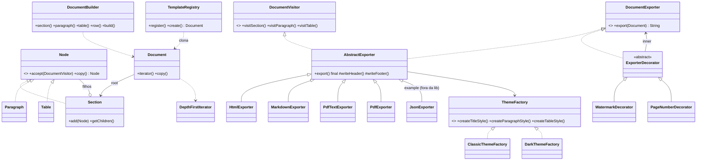

# Projeto Final de Design Patterns — Documentos/Exportação (Tema A)

Biblioteca Java 21 importável para montar documentos (seções, parágrafos, tabelas) e exportá-los
para vários formatos (HTML, Markdown e um "PDF" em texto simplificado). Novos formatos, temas e
efeitos entram **sem alterar a biblioteca** (Open/Closed).

## Integrantes

| Aluno | Nome completo | Patterns |
| --- | --- | --- |
| Aluno 1 | NOME COMPLETO | Builder + Composite |
| Aluno 2 | NOME COMPLETO | Visitor + Template Method |
| Aluno 3 | NOME COMPLETO | Decorator + Iterator |
| Aluno 4 | NOME COMPLETO | Abstract Factory + Prototype |

**Vídeo:** https://www.youtube.com/watch?v=COLOCAR_LINK_AQUI

## Estrutura

```
lib/      -> a biblioteca (br.pucpr.docs), com testes JUnit 5
  model/      Node, Section, Paragraph, Table, Document   (Composite, Prototype)
  builder/    DocumentBuilder                              (Builder)
  visitor/    DocumentVisitor                              (Visitor)
  export/     AbstractExporter, Html/Markdown/PdfText/Pdf  (Template Method + Visitor)
  theme/      ThemeFactory, Classic/Dark, Palette          (Abstract Factory)
  decorator/  Watermark/PageNumber                         (Decorator)
  iterator/   DepthFirstIterator                           (Iterator)
  prototype/  TemplateRegistry                             (Prototype)
example/  -> cliente que usa a lib (Main + JsonExporter criado fora da lib)
```

## Como rodar

```bash
./gradlew build            # compila e roda os testes
./gradlew :example:run     # roda a demonstração
```

## Como importar em outro projeto

Opção 1 — Maven local:

```bash
./gradlew :lib:publishToMavenLocal
```

```kotlin
repositories { mavenLocal(); mavenCentral() }
dependencies { implementation("br.pucpr:docs-patterns:0.1.0") }
```

Opção 2 — jar: `./gradlew :lib:jar` gera `lib/build/libs/lib-0.1.0.jar`, e no outro projeto:
`implementation(files("libs/lib-0.1.0.jar"))`.

Uso:

```java
Document doc = DocumentBuilder.create("Relatório")
    .author("Grupo")
    .section("Intro").paragraph("Olá").endSection()
    .section("Notas").table("Aluno", "Nota").row("Ana", "10").endSection()
    .build();

String html = new HtmlExporter(new DarkThemeFactory()).export(doc);
String pdf  = new PageNumberDecorator(new WatermarkDecorator(new PdfTextExporter(), "RASCUNHO"), 40)
                  .export(doc);
byte[] pdfReal = new PdfExporter().exportBytes(doc); // PDF binário de verdade
```

## Os 8 patterns

### 1. Builder — `builder/DocumentBuilder`
- **Problema:** montar uma árvore de nós na mão é verboso e fácil de errar.
- **Solução:** API fluente (`section().paragraph().endSection()`), que controla as seções abertas
  numa pilha e valida no `build()`.
- **Open/Closed:** o cliente monta qualquer documento sem conhecer as classes internas.

### 2. Composite — `model/Node`, `Section`, `Paragraph`, `Table`
- **Problema:** documentos têm seções dentro de seções, e queremos tratar tudo de forma uniforme.
- **Solução:** `Node` é o componente; `Section` é o composto (tem filhos); `Paragraph` e `Table`
  são folhas.
- **Open/Closed:** quem percorre a árvore só depende de `Node`.

### 3. Visitor — `visitor/DocumentVisitor`
- **Problema:** queremos várias operações (exportar em HTML, MD, JSON...) sem encher as classes do
  modelo de métodos `toHtml()`, `toMd()`...
- **Solução:** cada nó tem `accept(visitor)`; cada exportador é um visitante.
- **Open/Closed:** `example/JsonExporter` é um formato novo criado **fora da lib**, sem mudar nada nela.

### 4. Abstract Factory — `theme/ThemeFactory`, `ClassicThemeFactory`, `DarkThemeFactory`
- **Problema:** estilos de título, parágrafo e tabela precisam combinar entre si.
- **Solução:** cada fábrica cria a família inteira de estilos de um tema.
- **Open/Closed:** um tema novo é só uma fábrica nova; os exportadores não mudam.
- **Paleta:** a fábrica também cria uma `Palette` (cores, fontes do HTML/PDF/DOCX, tamanhos, zebra
  da tabela, verde/vermelho de destaque). `createPalette()` é um método `default` (devolve
  `Palette.neutra()`), então quem já implementava `ThemeFactory` continua compilando.
- **Destaque de linhas (Strategy):** `export/RowHighlighter` diz quais linhas da tabela destacar
  (`STRONG`, `POSITIVE`, `NEGATIVE`). Liga com `exporter.highlightRows(...)`; HTML, Markdown e PDF
  pintam com as cores da paleta. A lib não sabe a regra, quem sabe é o cliente.

### 5. Template Method — `export/AbstractExporter.export()`
- **Problema:** todo exportador segue o mesmo fluxo: cabeçalho → corpo → rodapé.
- **Solução:** `export()` é `final` e define a ordem; as subclasses implementam `writeHeader`,
  `writeSectionTitle`, `visitParagraph`, `visitTable`, e opcionalmente o hook `writeFooter`.
- **Open/Closed:** o fluxo é fechado pra mudança, e os passos são abertos pra extensão.

### 6. Decorator — `decorator/ExporterDecorator`, `WatermarkDecorator`, `PageNumberDecorator`
- **Problema:** marca d'água e numeração deveriam funcionar com qualquer formato, sem criar
  `HtmlComMarcaDagua`, `PdfComNumeracao`...
- **Solução:** o decorator implementa `DocumentExporter`, embrulha outro exportador e altera a
  saída. Dá pra empilhar.
- **Open/Closed:** efeito novo = decorator novo.

### 7. Prototype — `Node.copy()`, `Document.copy()`, `prototype/TemplateRegistry`
- **Problema:** reaproveitar documentos-modelo sem que a edição de um altere o outro.
- **Solução:** cópia profunda; o registro guarda os modelos e sempre devolve um clone.
- **Open/Closed:** templates novos são registrados em tempo de execução.

### 8. Iterator — `iterator/DepthFirstIterator`, `Document implements Iterable<Node>`
- **Problema:** percorrer todos os nós sem expor a estrutura nem escrever recursão toda vez.
- **Solução:** iterador em profundidade (pré-ordem) com uma pilha; `for (Node n : doc)`.
- **Open/Closed:** outros percursos (ex: em largura) seriam iteradores novos.

## Diagrama de classes



## Próximos passos (até a final em 12/11)
- ~~PDF de verdade~~ feito: `PdfExporter`, escrito na mão, sem dependência.
- Mais um tema e mais um decorator (ex: sumário).
- Spotless/SpotBugs como no repo do professor.
